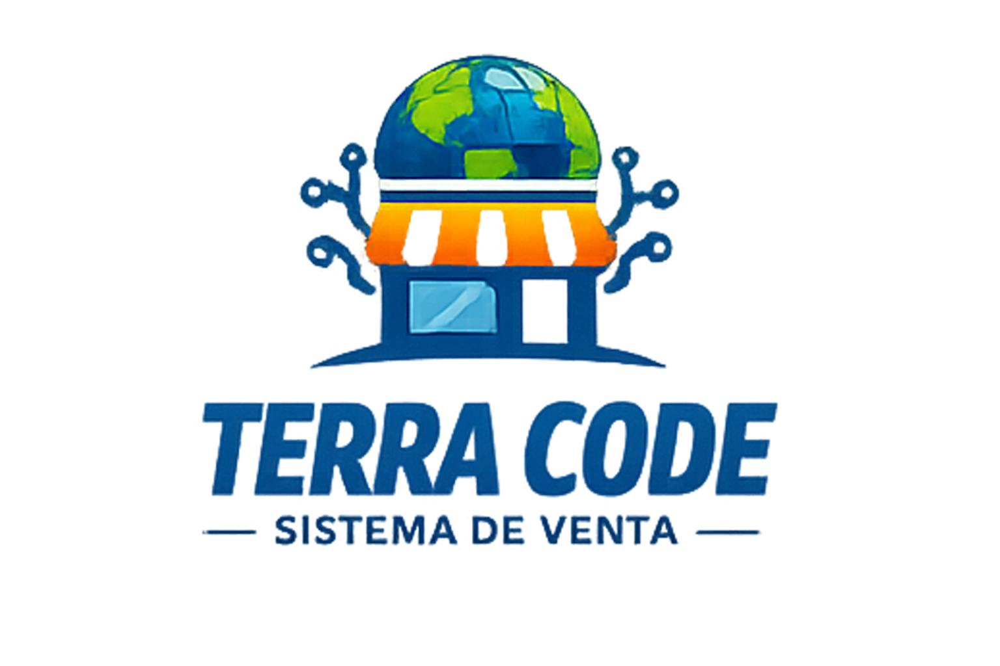
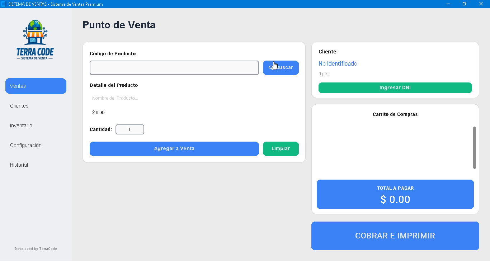
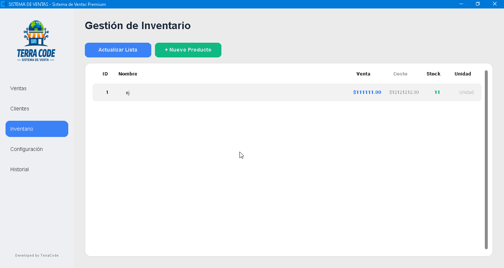
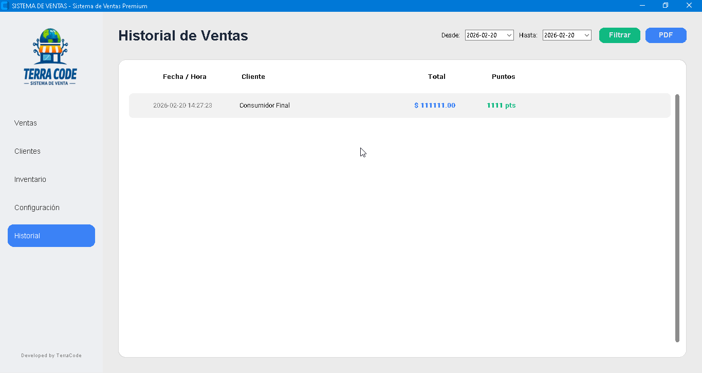
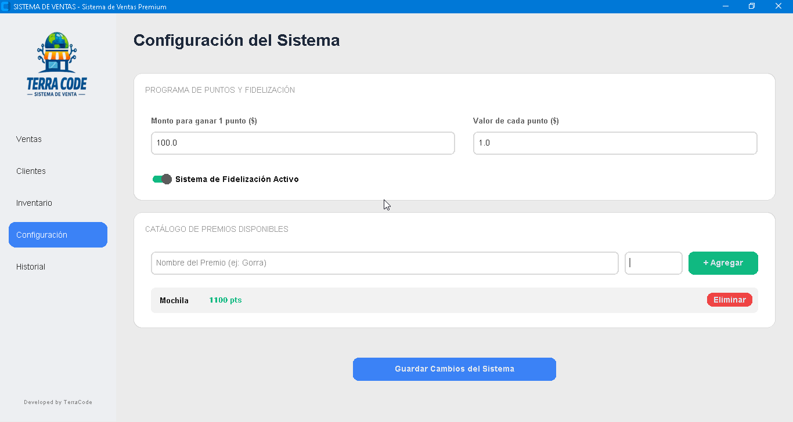

<div align="center">

  

  # Terra Code — Gestión de Ventas y Sistema de Puntos

  **Sitio web oficial y presentación interactiva de Terra Code Gestión Premium (TerraCodeTienda)**  
  *Solución integral de punto de venta (POS), control de inventario y fidelización de clientes.*

  <p>
    <a href="https://terracode.com.ar" target="_blank" rel="noopener noreferrer">
      
    </a>
    <a href="https://www.linkedin.com/in/luciano-ruizdiaz/" target="_blank" rel="noopener noreferrer">
      
    </a>
    <a href="mailto:lurdciano@gmail.com">
      
    </a>
    <a href="LICENSE">
      
    </a>
  </p>

</div>

---

## 📌 Descripción del Proyecto

**TiendaPuntosWeb** es el portal web oficial y showcase interactivo desarrollado para presentar **Terra Code - Gestión de Ventas**. El software está diseñado para comercios y puntos de venta que requieren un control riguroso de sus operaciones diarias, soporte para múltiples métodos de pago, base de datos local robusta y un sistema dinámico de fidelización para clientes recurrentes.

La plataforma web ofrece una experiencia fluida, moderna y responsive con visualizador multimedia integrado (lightbox) para imágenes en alta resolución y demostración en video.

---

## 📸 Capturas de Pantalla Reales

A continuación se presentan capturas reales de la interfaz del software:

### 1. Pantalla Principal y Panel de Control
Vista general del sistema con accesos directos rápidos a los módulos operativos y métricas clave.

<div align="center">
  
</div>

<br/>

### 2. Módulo de Caja (Punto de Venta - POS)
Interfaz ágil para ventas rápidas con soporte para lectores de códigos de barra, balanza por peso (Kg), cálculo de vuelto y selección de medios de pago (efectivo, transferencia y puntos).

<div align="center">
  
</div>

<br/>

### 3. Control de Inventario y Stock
Administración centralizada de productos con categorización inteligente, costos, precios de venta, márgenes de ganancia y alertas automáticas de reposición.

<div align="center">
  
</div>

<br/>

### 4. Historial de Operaciones y Resumen Financiero
Auditoría cronológica de transacciones, balance por medio de pago y seguimiento de ventas.

<div align="center">
  
</div>

<br/>

### 5. Sistema de Fidelización y Canje de Premios
Motor de puntos donde cada compra acumula saldo para el cliente, permitiendo canjes por descuentos o productos del catálogo.

<div align="center">
  
</div>

<br/>

> 🎥 **Video Demostración:** El repositorio también incluye una demostración en video interactiva en [`images/Demo.mp4`](images/Demo.mp4), reproducible directamente desde la landing page mediante el reproductor modal integrado.

---

## ✨ Características Principales del Sistema

- 🛒 **Punto de Venta Ágil (POS):** Búsqueda instantánea por código o descripción, venta por unidad o balanza, y emisión rápida de comprobantes.
- 💳 **Múltiples Formas de Pago:** Registro discriminado de efectivo, transferencias y pagos combinados con puntos de fidelización.
- 🎁 **Fidelización y Premios:** Acumulación automática de puntos por volumen de compra y gestión de canjes.
- 📦 **Control de Stock en Tiempo Real:** Bloqueo o advertencia preventiva ante quiebre de existencias.
- 💾 **Persistencia y Respaldo Confiable:** Motor de base de datos relacional SQLite y generación automática de respaldos redundantes en la carpeta `backups/`.
- ⚡ **Portabilidad Total:** Ejecución nativa y liviana en entorno de escritorio Windows sin configuraciones complejas ni servidores externos obligatorios.

---

## 🔒 Seguridad y Buenas Prácticas Implementadas

Se revisó y fortaleció la seguridad del proyecto aplicando directrices de desarrollo seguro:

1. **Content Security Policy (CSP) Estricto:**
   - Restricción de fuentes autorizadas para scripts, estilos, fuentes, imágenes y multimedia.
   - Directivas de contención `base-uri 'self'` (evita secuestro de rutas base) y `object-src 'none'` (bloqueo de plugins vulnerables).
2. **Mitigación de DOM-based XSS:**
   - La manipulación del visor modal se realiza exclusivamente mediante métodos seguros de la API del DOM (`replaceChildren()`, `createElement()`) en lugar de inyecciones de cadenas HTML sin escapar (`innerHTML`).
3. **Navegación Externa Segura:**
   - Todos los hipervínculos salientes incorporan el atributo `rel="noopener noreferrer"` para proteger contra vulnerabilidades de *tabnabbing* y fuga de referrers.
4. **Cabeceras de Protección en Metadatos:**
   - `X-Content-Type-Options: nosniff` para evitar interpretaciones erróneas de tipos MIME.
   - `Referrer-Policy: strict-origin-when-cross-origin` para privacidad de navegación.
5. **Aislamiento en Control de Versiones:**
   - Archivo [`.gitignore`](.gitignore) estructurado para prevenir la subida inadvertida de variables de entorno, claves secretas, archivos del sistema operativo o carpetas de configuración de IDEs.

---

## 💻 Requisitos Técnicos

### Para la Web (TiendaPuntosWeb):
- Cualquier navegador web moderno (Google Chrome, Mozilla Firefox, Microsoft Edge, Safari, Brave).
- Compatible con despliegue en **GitHub Pages**, Vercel, Netlify o cualquier servidor estático (Nginx, Apache, Caddy).

### Para el Software de Gestión (TerraCodeTienda):
- **Sistema Operativo:** Windows 7, 10, 11 (64-bit).
- **Memoria RAM:** Mínimo 4 GB.
- **Almacenamiento:** 200 MB de espacio disponible.
- **Software opcional:** Microsoft Excel (para visualización externa de reportes) y lector de PDF.

---

## 📂 Estructura del Repositorio

```plaintext
TiendaPuntosWeb/
├── .gitattributes          # Normalización de saltos de línea LF/CRLF
├── .gitignore              # Exclusión de archivos sensibles y temporales
├── LICENSE                 # Licencia MIT de código abierto
├── README.md               # Documentación general y galería de capturas
├── index.html              # Landing page principal, estilos CSS y scripts
└── images/                 # Recursos multimedia y capturas reales
    ├── Caja.png            # Captura del módulo de caja
    ├── Demo.mp4            # Video demostrativo
    ├── Historial.png       # Captura del historial de operaciones
    ├── Inventario.png      # Captura de la sección de inventario
    ├── logo_main.png       # Logotipo oficial de TerraCode
    ├── Principal.png       # Captura de la pantalla principal
    └── Puntos.png          # Captura del sistema de puntos
```

---

## 🚀 Despliegue y Visualización Local

Para visualizar el sitio web localmente:

1. Clona el repositorio:
   ```bash
   git clone https://github.com/Lurdciano/TiendaPuntosWeb.git
   cd TiendaPuntosWeb
   ```
2. Abre `index.html` en tu navegador predeterminado:
   - En Windows (PowerShell):
     ```powershell
     Start-Process index.html
     ```
   - O usando la extensión **Live Server** en Visual Studio Code.

---

## 👨‍💻 Autor y Contacto

Desarrollado y mantenido por **Luciano Ruiz Diaz**:

- 🌐 **Sitio Web:** [terracode.com.ar](https://terracode.com.ar)
- 💼 **LinkedIn:** [luciano-ruizdiaz](https://www.linkedin.com/in/luciano-ruizdiaz/)
- ✉️ **Correo Electrónico:** [lurdciano@gmail.com](mailto:lurdciano@gmail.com)

---

## 📄 Licencia

Este proyecto se encuentra bajo la Licencia [MIT](LICENSE). Puedes utilizarlo libremente con fines personales o comerciales, respetando los créditos del autor.
